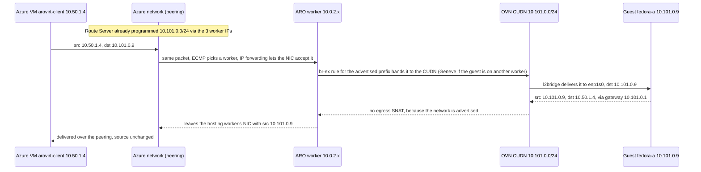

# Customer demo guide: native, no-NAT networking from an Azure VM to OpenShift Virtualization guests on ARO

This is a step-by-step script for showing a customer that an ordinary Azure VM can reach virtual machines that run on OpenShift Virtualization on Azure Red Hat OpenShift (ARO) x86 workers **at their real IP addresses, with no NAT**, and that those guests reach the Azure VM the same way. It covers four things:

- what is configured and deployed
- how the configuration is set up, on the Azure side and in OpenShift
- how to prove live that the guest network is routed natively, in both directions
- how to answer the questions customers usually ask, including the support position

It assumes you have deployed the lab with the scripts in this repository (see [../README.md](../README.md)). For the problems hit while building it, see [lessons-learned.md](lessons-learned.md).

> **Read this first: support boundary.** This lab is an experiment. It is **not** a supported ARO configuration. In OpenShift 4.21, Red Hat documents BGP route advertisements for bare-metal clusters only, and enabling IP forwarding on worker NICs in the ARO managed resource group is outside the normal ARO support model. Present it as "this is how the mechanism works, and this is what we measured", not as a production design. See [Position it honestly](#position-it-honestly).

| | |
|---|---|
| Duration | 40 to 50 minutes. The core story takes about 20 minutes (see [Short version](#short-version-20-minutes)). |
| Audience | Platform, networking, security and virtualization (VMware migration) engineers |
| Environment | One resource group (`RESOURCE_GROUP` in `lab.env`, default `arovirt-rg`) holding ARO, Route Server, both VNets and the Azure test VM. ARO creates its managed resource group `arovirt-rg-managed`. |
| Cluster | `arovirt-aro-<suffix>`: ARO with OpenShift 4.21 or later, 3 x `Standard_D8s_v5` masters and 3 x `Standard_E8as_v5` (AMD x86) workers, running OpenShift Virtualization from the `stable` channel |

## Contents

- [0. Before the demo](#0-before-the-demo)
- [1. The story and architecture](#1-the-story-and-architecture)
- [2. Before and after: what NAT used to hide](#2-before-and-after-what-nat-used-to-hide)
- [3. Azure side: Route Server, peering and forwarding](#3-azure-side-route-server-peering-and-forwarding)
- [4. Walk through the OpenShift configuration](#4-walk-through-the-openshift-configuration)
- [5. Prove BGP is up](#5-prove-bgp-is-up)
- [6. Prove Azure routes the guest network natively](#6-prove-azure-routes-the-guest-network-natively)
- [7. Live demo: real IPs in both directions](#7-live-demo-real-ips-in-both-directions)
- [8. The packet path: why there is no NAT](#8-the-packet-path-why-there-is-no-nat)
- [9. Recorded evidence: the 12-case matrix](#9-recorded-evidence-the-12-case-matrix)
- [10. Talking points and FAQ](#10-talking-points-and-faq)
- [11. Reset after the demo](#11-reset-after-the-demo)
- [Short version (20 minutes)](#short-version-20-minutes)
- [Proof checklist](#proof-checklist)

## 0. Before the demo

### Your access

| Access | Scope | What it gives you |
|---|---|---|
| Reader or higher (Azure RBAC) | The lab resource group and the ARO managed resource group | Read Route Server peers and routes, NIC effective routes, VNet peerings and NSGs; portal access. Adding a temporary NSG rule needs Network Contributor or higher on the lab resource group. |
| ARO admin kubeconfig | The lab cluster | Cluster-admin `oc` access. `scripts/03-configure-cluster.sh` writes it to `.arovirt/kubeconfig`. |
| SSH private key | Azure test VM `arovirt-client` and the two guests | The private key that matches the public key you deployed with. SSH to the Azure VM as `azureuser` and, through it, to the guests as `fedora`. |

Do not copy private keys to the Azure VM. SSH jumps through it with `ssh -J`, so the key stays on your machine.

### Connect to the cluster and the test VM

The ARO API and console are public. From the repository root, sign in to Azure and set the shell variables that every command in this guide uses:

```bash
az login
source lab.env
RG=$RESOURCE_GROUP
out() { az deployment group show -g "$RG" -n arovirt --query "properties.outputs.$1.value" -o tsv; }
CLUSTER=$(out clusterName)
MRG=$(out managedResourceGroupName)
RS=$(out routeServerName)
CLIENT_IP=$(out clientVmPublicIp)
export KUBECONFIG=$PWD/.arovirt/kubeconfig
oc whoami --show-server
```

Expected: `https://api.arovirt-<suffix>.<region>.aroapp.io:6443`, the same value as the `apiServerUrl` deployment output. Every `oc` command in this guide also works with `kubectl`. If `.arovirt/kubeconfig` is missing, get it with `az aro get-admin-kubeconfig -g "$RG" -n "$CLUSTER" --file .arovirt/kubeconfig`.

Shortcut: `eval "$(scripts/demo.sh env)"` sets the same variables (plus `GA` and `GB`, below) in one step. See [run-and-demo.md](run-and-demo.md#run-the-demo).

The guest network is private, so the demo uses the Azure test VM (`arovirt-client`, `10.50.1.4`) both as the test client and as the SSH jump host. Its public IP is for management only. SSH is allowed only from the `MY_IP` address in `lab.env`, by rule `Allow-SSH-MyIp` (priority 100) on the subnet NSG `arovirt-client-nsg`. There is no NIC NSG, so this is the only rule that matters.

If you present from somewhere else, add a temporary rule for your current IP:

```bash
MYIP="$(curl -s https://api.ipify.org)/32"
az network nsg rule create -g "$RG" --nsg-name arovirt-client-nsg -n Temp-Demo-SSH \
  --priority 110 --direction Inbound --access Allow --protocol Tcp --destination-port-ranges 22 \
  --source-address-prefixes "$MYIP" --destination-address-prefixes 10.50.1.4/32
```

Guest IPs are allocated by persistent IPAM, so they are not fixed. Read them from the cluster:

```bash
oc get vmi -n arovirt-guests
GA=$(oc get vmi fedora-a -n arovirt-guests -o jsonpath='{.status.interfaces[0].ipAddress}')
GB=$(oc get vmi fedora-b -n arovirt-guests -o jsonpath='{.status.interfaces[0].ipAddress}')
echo "fedora-a=$GA fedora-b=$GB"
```

The guests are reached **through** the Azure VM, so every SSH session to a guest is already native routing from `10.50.1.4` to `10.101.0.x`. Test all three:

```bash
ssh azureuser@$CLIENT_IP hostname
ssh -J azureuser@$CLIENT_IP fedora@$GA hostname
ssh -J azureuser@$CLIENT_IP fedora@$GB hostname
```

Expected: `arovirt-client`, `fedora-a` and `fedora-b`.

> **About the sample output in this guide.** The samples show `fedora-a` as `10.101.0.9` and `fedora-b` as `10.101.0.8`, the addresses recorded in the original build of this lab. Your guests may get different addresses from `10.101.0.0/24`. Worker names, node names and timings are also examples. The client VM is always `10.50.1.4`.

### Pre-flight (5 minutes before the customer joins)

Run the read-only readiness check:

```bash
scripts/verify.sh
```

It prints the BGP sessions on each worker, the routes Route Server has learned, the client NIC's effective routes for the guest network, the guest IPs, and a ping from the client VM to each guest. Expected: two Established sessions per worker, `10.101.0.0/24` learned from all three workers, three active `10.101.0.0/24` routes on the client NIC, and 0% loss to both guests.

You can also check the pieces by hand:

```bash
oc get nodes                                         # 6 nodes Ready (3 masters, 3 workers)
oc get vmi -n arovirt-guests                         # fedora-a and fedora-b Running, each with a 10.101.0.x IP
oc get routeadvertisements                           # arovirt-guests  Accepted
oc get ds frr-k8s -n openshift-frr-k8s               # 6 desired, 6 ready
az network nic show-effective-route-table -g "$RG" -n arovirt-client-nic -o table | grep 10.101   # 3 Active routes
ssh azureuser@$CLIENT_IP "ping -c 2 $GA; ping -c 2 $GB"                                          # 0% loss
```

Open these browser tabs:

1. The OpenShift console (the `consoleUrl` deployment output, or `az aro show -g "$RG" -n "$CLUSTER" --query consoleProfile.url -o tsv`), on **Virtualization > VirtualMachines**, project `arovirt-guests`.
2. The Azure portal, on Route Server `arovirt-rs` > **Peers**.
3. The Azure portal, on NIC `arovirt-client-nic` > **Effective routes**.
4. This guide.

Have two terminals ready for [section 7](#7-live-demo-real-ips-in-both-directions): one for the guest side and one for the Azure VM side. Run the setup block above, including `GA` and `GB`, in both.

## 1. The story and architecture

**Message:** "OpenShift Virtualization on ARO lets you run VMs next to containers. By default, those VMs sit behind NAT, so the rest of Azure only ever sees a worker node's IP. In this lab, the guest network is a real, routed network in Azure. The ARO workers announce it over BGP to Azure Route Server, Azure programs that route into the peered VNet, and an ordinary Azure VM talks to each guest at its own IP. Each guest sees the Azure VM's own IP too. No NAT, no user-defined routes, no network virtual appliance."


Route Server is only the control plane (dashed blue lines): the workers advertise the guest network to it over BGP, and it programs that route into the client VNet. Packets go directly between the Azure VM and the guests over the peering, with no NAT (solid purple line). The worker IPs are assigned by Azure at deploy time and are typically `10.0.2.4`, `.5` and `.6`.

What is deployed (Azure resources in [../infra/main.bicep](../infra/main.bicep) and [../infra/route-server-peers.bicep](../infra/route-server-peers.bicep), cluster objects in [../cluster/](../cluster/)):

| Layer | Component | Configuration |
|---|---|---|
| ARO network | VNet `arovirt-aro-vnet`, `10.0.0.0/20` | Subnets `control-plane` `10.0.0.0/23`, `workers` `10.0.2.0/23`, `RouteServerSubnet` `10.0.4.0/26`. No route tables. |
| Client network | VNet `arovirt-client-vnet`, `10.50.0.0/16` | Subnet `client` `10.50.1.0/24` with NSG `arovirt-client-nsg`. No route table. Peered to the ARO VNet. |
| Routing control plane | Azure Route Server `arovirt-rs` | ASN 65515, instances `10.0.4.4` and `10.0.4.5`, branch-to-branch off, 3 BGP peers (the workers) |
| ARO | `arovirt-aro-<suffix>` | OpenShift 4.21 or later, public API and ingress, 3 x `Standard_D8s_v5` masters, 3 x `Standard_E8as_v5` workers. Pod network `10.128.0.0/14`, services `172.30.0.0/16`. |
| Virtualization | OpenShift Virtualization, `stable` channel | `HyperConverged` with common boot image import turned off |
| Cluster routing | Cluster Network Operator with FRR | `additionalRoutingCapabilities.providers: [FRR]`, `routeAdvertisements: Enabled`, FRR-K8s on all 6 nodes. One `FRRConfiguration`, `route-server`, peers the 3 workers (ASN 65001) with Route Server. |
| Guest network | `ClusterUserDefinedNetwork` `arovirt-guests` | Primary Layer2 network `10.101.0.0/24`, persistent IPAM, advertised by `RouteAdvertisements` `arovirt-guests` |
| Guests | `fedora-a` and `fedora-b` in namespace `arovirt-guests` | Fedora cloud image, 2 vCPU and 4 GiB, `l2bridge` binding, anti-affinity across workers, 30 GiB root disk on the default ARO storage class |
| Test client | Azure VM `arovirt-client` | `Standard_D2s_v5`, Ubuntu 24.04, static `10.50.1.4`, NIC IP forwarding off, public IP for SSH management only |

## 2. Before and after: what NAT used to hide

**Message:** "Out of the box, a VM on OpenShift Virtualization is behind two layers of NAT. This lab removes both, without any tunnel or appliance."

| | Default (masquerade on the pod network) | This lab (l2bridge on an advertised primary UDN) |
|---|---|---|
| Address inside the guest | Private `192.168.100.2` | The guest's own `10.101.0.x` on the guest NIC |
| Source IP seen by an Azure VM when the guest connects out | A worker node IP | The guest's own `10.101.0.x` IP |
| How an Azure VM connects in | A `Service` (NodePort or LoadBalancer) per port | Directly to the guest IP, on any port your rules allow |
| What Azure NSG rules can match | Worker subnet IPs | The guest CIDR `10.101.0.0/24` |
| Azure route for the guest network | None | Learned over BGP, 3 equal-cost next hops |

A baseline recorded in the original build of this lab (13 September 2026) showed the default behaviour. The guest used `192.168.100.2`. KubeVirt masquerade translated it to the launcher pod IP `10.131.0.36`, and OVN then translated that to the worker IP. The Azure client saw only the worker.

Now show the guest from the inside:

```bash
ssh -J azureuser@$CLIENT_IP fedora@$GA 'ip -4 -br addr show enp1s0; ip route'
```

Expected (example IPs):

```text
enp1s0           UP             10.101.0.9/24
default via 10.101.0.1 dev enp1s0 proto dhcp src 10.101.0.9 metric 100
10.101.0.0/24 dev enp1s0 proto kernel scope link src 10.101.0.9 metric 100
```

Point out:

- The guest itself owns its `10.101.0.x` address. There is no `192.168.100.x` address and nothing to translate.
- It got the address by DHCP from OVN. The default gateway `10.101.0.1` is the OVN gateway router for this network.
- The same address is what the Azure VM will see in [section 7](#7-live-demo-real-ips-in-both-directions).

In the OpenShift console, open **Virtualization > VirtualMachines > fedora-a**. The **Overview** and **Network** tabs show the same `10.101.0.x` address on the `default` interface.

## 3. Azure side: Route Server, peering and forwarding

**Message:** "Azure knows nothing about OpenShift. It learns the guest network the same way it learns routes from any network appliance: over BGP, through Route Server."

### 3.1 Route Server and its three peers

```bash
az network routeserver show -g "$RG" -n "$RS" \
  --query "{asn:virtualRouterAsn, ips:join(',', virtualRouterIps), branchToBranch:allowBranchToBranchTraffic, state:provisioningState}" -o table
az network routeserver peering list -g "$RG" --routeserver "$RS" \
  --query "[].{name:name, peerIp:peerIp, peerAsn:peerAsn, state:provisioningState}" -o table
```

Expected:

```text
Asn    Ips                BranchToBranch    State
-----  -----------------  ----------------  ---------
65515  10.0.4.5,10.0.4.4  False             Succeeded

Name                   PeerIp    PeerAsn    State
---------------------  --------  ---------  ---------
<worker 1 VM name>     10.0.2.4  65001      Succeeded
<worker 2 VM name>     10.0.2.5  65001      Succeeded
<worker 3 VM name>     10.0.2.6  65001      Succeeded
```

Each peer is named after the worker VM it points to (`arovirt-aro-<suffix>-<infra ID>-worker-<zone>-<ID>`).

Point out:

- The three BGP peers are the three ARO workers themselves. There is no separate router VM or appliance.
- Route Server always runs two instances, so there are 3 x 2 = 6 eBGP sessions on TCP 179.
- Branch-to-branch is off, so the guest network is not passed on to VPN or ExpressRoute gateways in this lab.
- The peers are created by [../infra/route-server-peers.bicep](../infra/route-server-peers.bicep), which [../scripts/02-configure-routing.sh](../scripts/02-configure-routing.sh) deploys with the worker names and NIC IPs it discovers.

### 3.2 Peering with gateway transit

```bash
for v in arovirt-aro-vnet arovirt-client-vnet; do
  az network vnet peering list -g "$RG" --vnet-name "$v" \
    --query "[].{name:name, state:peeringState, forwarded:allowForwardedTraffic, gatewayTransit:allowGatewayTransit, useRemoteGateways:useRemoteGateways}" -o table
done
```

Expected:

```text
Name           State      Forwarded    GatewayTransit    UseRemoteGateways
-------------  ---------  -----------  ----------------  -------------------
aro-to-client  Connected  True         True              False

Name           State      Forwarded    GatewayTransit    UseRemoteGateways
-------------  ---------  -----------  ----------------  -------------------
client-to-aro  Connected  True         False             True
```

Point out:

- **Gateway transit** on the ARO side and **use remote gateways** on the client side are what let Route Server program the learned route into the peered client VNet.
- **Allow forwarded traffic** is on in both directions. Traffic to `10.101.0.0/24` is forwarded by a worker, because that address is not on the worker's NIC.

### 3.3 Worker NICs can forward

```bash
az network nic list -g "$MRG" \
  --query "[?contains(name, 'worker')].{name:name, ip:ipConfigurations[0].privateIPAddress, ipForwarding:enableIPForwarding}" -o table
```

Expected: the three worker NICs (typically `10.0.2.4`, `10.0.2.5` and `10.0.2.6`) show `ipForwarding` `True`. The masters do not need it.

Point out:

- Without IP forwarding, Azure drops packets whose destination (inbound) or source (outbound) is not the NIC's own IP. The guest IPs are neither.
- These NICs live in the ARO **managed** resource group, which has a deny assignment. [../scripts/02-configure-routing.sh](../scripts/02-configure-routing.sh) turns IP forwarding on by signing in as the ARO cluster service principal, which is excluded from the deny assignment. A human Owner gets `LinkedAuthorizationFailed`, because updating the NIC also rejoins it to the load balancer backend pool. This is one of the reasons the setup is unsupported (see [section 10](#position-it-honestly)).
- The setting does not carry over to replacement workers. After any worker change (scale, replace, upgrade that recreates a VM), rerun `scripts/02-configure-routing.sh` and then `scripts/03-configure-cluster.sh` (which labels the new worker as a BGP speaker).
- The test VM's NIC does **not** have IP forwarding. It is an ordinary Azure VM.

### 3.4 No user-defined routes anywhere

```bash
az network vnet subnet show -g "$RG" --vnet-name arovirt-client-vnet -n client --query "routeTable.id" -o tsv
az network vnet subnet show -g "$RG" --vnet-name arovirt-aro-vnet -n workers --query "routeTable.id" -o tsv
```

Expected: no output from either command. Neither subnet has a route table. Every route in this demo is learned dynamically.

To show how the Azure side is built, open [../infra/main.bicep](../infra/main.bicep), [../infra/route-server-peers.bicep](../infra/route-server-peers.bicep) and [../scripts/02-configure-routing.sh](../scripts/02-configure-routing.sh).

## 4. Walk through the OpenShift configuration

**Message:** "There are four small pieces of configuration. Turn on FRR and route advertisements in the network operator. Describe the BGP peering once. Create the VM network. Say that this network should be advertised."

All of it is applied by [../scripts/03-configure-cluster.sh](../scripts/03-configure-cluster.sh) from the manifests in [../cluster/](../cluster/).

### 4.1 Cluster Network Operator: FRR and route advertisements

```bash
oc get network.operator cluster -o jsonpath='{.spec.additionalRoutingCapabilities}{"\n"}{.spec.defaultNetwork.ovnKubernetesConfig.routeAdvertisements}{"\n"}{.spec.defaultNetwork.ovnKubernetesConfig.gatewayConfig.routingViaHost}{"\n"}'
oc get ds frr-k8s -n openshift-frr-k8s
```

Expected:

```text
{"providers":["FRR"]}
Enabled
false

NAME      DESIRED   CURRENT   READY   UP-TO-DATE   AVAILABLE   NODE SELECTOR            AGE
frr-k8s   6         6         6       6            6           kubernetes.io/os=linux   16d
```

This is the only change to the cluster network operator:

```yaml
spec:
  additionalRoutingCapabilities:
    providers: ["FRR"]
  defaultNetwork:
    ovnKubernetesConfig:
      routeAdvertisements: Enabled
```

Point out:

- No `FeatureGate` change is needed. The cluster runs the default feature set (no `TechPreviewNoUpgrade`), because basic BGP route advertisements have been in the default feature set since OpenShift 4.19.
- FRR-K8s runs on all 6 nodes. Only the 3 labelled workers peer with Azure.
- `routingViaHost: false` means OVN uses shared gateway mode. Packets for the guest network are handed from the worker's `br-ex` bridge straight into OVN (see [section 8](#8-the-packet-path-why-there-is-no-nat)).

### 4.2 The BGP peering: one FRRConfiguration

```bash
oc get frrconfiguration -n openshift-frr-k8s
oc get frrconfiguration route-server -n openshift-frr-k8s -o yaml
```

Expected: `route-server` and three `ovnk-generated-*` configurations. The relevant part of `route-server` ([../cluster/frr-configuration.yaml](../cluster/frr-configuration.yaml)) is:

```yaml
metadata:
  labels:
    arovirt.io/bgp: route-server
spec:
  nodeSelector:
    matchLabels:
      arovirt.io/bgp-speaker: "true"
  bgp:
    routers:
    - asn: 65001
      neighbors:
      - address: 10.0.4.4
        asn: 65515
        ebgpMultiHop: true
        disableMP: true
        toAdvertise:
          allowed:
            mode: all
        toReceive:
          allowed:
            mode: filtered
            prefixes:
            - prefix: 10.50.0.0/16
      - address: 10.0.4.5
        # same settings as 10.0.4.4
```

Point out:

- It selects only the nodes labelled `arovirt.io/bgp-speaker: "true"`. The script labels all three workers. Those are the BGP speakers.
- It peers with **both** Route Server instances. `ebgpMultiHop` is needed because Route Server is in a different subnet from the workers.
- It accepts **only** the client VNet `10.50.0.0/16` from Azure. The cluster cannot learn anything else.
- It says nothing about the guest network. OVN-Kubernetes generates one `ovnk-generated-*` configuration per worker that adds the `10.101.0.0/24` prefix. Show one with `oc get frrconfiguration -n openshift-frr-k8s ovnk-generated-<suffix> -o jsonpath='{.spec.bgp.routers[0].prefixes}'`, which returns `["10.101.0.0/24"]`.
- Do not edit or delete this object during a demo. Removing it drops all six BGP sessions.

### 4.3 The VM network: a primary Layer2 ClusterUserDefinedNetwork

```bash
oc get namespace arovirt-guests --show-labels
oc get clusteruserdefinednetwork arovirt-guests -o yaml
```

The relevant part ([../cluster/guest-network.yaml](../cluster/guest-network.yaml)):

```yaml
metadata:
  labels:
    arovirt.io/advertise: "true"
spec:
  namespaceSelector:
    matchLabels:
      kubernetes.io/metadata.name: arovirt-guests
  network:
    topology: Layer2
    layer2:
      role: Primary
      subnets: ["10.101.0.0/24"]
      ipam:
        mode: Enabled
        lifecycle: Persistent
status:
  conditions:
  - type: NetworkCreated
    status: "True"
    reason: NetworkAttachmentDefinitionCreated
```

Point out:

- `role: Primary` makes this the main network for every pod and VM in the namespace. They are not attached to the default pod network.
- `Layer2` is one flat subnet across all workers. A guest keeps the same subnet whichever worker it runs on.
- `lifecycle: Persistent` keeps each VM's IP across restarts.
- The namespace must carry the `k8s.ovn.org/primary-user-defined-network` label when it is created. It cannot be added later.

### 4.4 Advertise the network: RouteAdvertisements

```bash
oc get routeadvertisements arovirt-guests -o yaml
```

The relevant part ([../cluster/route-advertisements.yaml](../cluster/route-advertisements.yaml)):

```yaml
spec:
  advertisements: ["PodNetwork"]
  nodeSelector: {}
  frrConfigurationSelector:
    matchLabels:
      arovirt.io/bgp: route-server
  networkSelectors:
  - networkSelectionType: ClusterUserDefinedNetworks
    clusterUserDefinedNetworkSelector:
      networkSelector:
        matchLabels:
          arovirt.io/advertise: "true"
status:
  conditions:
  - type: Accepted
    status: "True"
    reason: Accepted
    message: ovn-kubernetes cluster-manager validated the resource and requested the necessary configuration changes
```

Point out:

- It advertises exactly one network, the `arovirt-guests` CUDN, and nothing else. The default pod network is not advertised.
- `nodeSelector: {}` is required for `PodNetwork`. The `route-server` FRR configuration's own selector limits the speakers to the three workers.
- As soon as a network is advertised, OVN **stops source NAT** for its traffic leaving the cluster. That is the second NAT layer gone. It is also why the script waits for the guests to finish installing their packages before it creates the advertisement (see [section 10](#common-questions)).

### 4.5 The VM: l2bridge binding

```bash
oc get vm fedora-a -n arovirt-guests \
  -o jsonpath='{.spec.template.spec.domain.devices.interfaces}{"\n"}{.spec.template.spec.networks}{"\n"}'
oc get vmi -n arovirt-guests -o wide
```

Expected (the first two lines reflect [../cluster/guests.yaml](../cluster/guests.yaml); IPs and node names are examples):

```text
[{"binding":{"name":"l2bridge"},"name":"default"}]
[{"name":"default","pod":{}}]

NAME       AGE   PHASE     IP           NODENAME                                                 READY
fedora-a   15d   Running   10.101.0.9   arovirt-aro-<suffix>-<infra ID>-worker-<zone 3>-<ID>     True
fedora-b   15d   Running   10.101.0.8   arovirt-aro-<suffix>-<infra ID>-worker-<zone 1>-<ID>     True
```

Point out:

- `pod: {}` means "the namespace's primary network", which is the CUDN.
- `binding: l2bridge` hands the CUDN address straight to the guest NIC. That is the first NAT layer gone: with the default `masquerade` binding, the guest would get `192.168.100.2` instead.
- The two guests run on different workers (anti-affinity), so the demo covers both the local and the cross-worker (Geneve) path.

To show how the guest objects are built, open [../cluster/guest-network.yaml](../cluster/guest-network.yaml), [../cluster/guests.yaml](../cluster/guests.yaml) and [../cluster/route-advertisements.yaml](../cluster/route-advertisements.yaml).

## 5. Prove BGP is up

**Message:** "Each worker runs FRR and holds an eBGP session with both Route Server instances. Let's look at it from both sides."

### 5.1 From inside the cluster

```bash
NODE=$(oc get vmi fedora-b -n arovirt-guests -o jsonpath='{.status.nodeName}')
POD=$(oc get pods -n openshift-frr-k8s -l app=frr-k8s --field-selector spec.nodeName=$NODE -o name)
oc exec -n openshift-frr-k8s "$POD" -c frr -- vtysh -c "show bgp summary"
oc exec -n openshift-frr-k8s "$POD" -c frr -- vtysh -c "show bgp ipv4 unicast"
```

Expected (trimmed, recorded in the original build of this lab):

```text
BGP router identifier 10.128.2.2, local AS number 65001 vrf-id 0

Neighbor        V         AS   MsgRcvd   MsgSent   TblVer  InQ OutQ  Up/Down State/PfxRcd   PfxSnt Desc
10.0.4.4        4      65515     26707     23350        0    0    0 02w2d05h            1        1 N/A
10.0.4.5        4      65515     26668     23350        0    0    0 02w2d05h            1        1 N/A

    Network          Next Hop            Metric LocPrf Weight Path
 *= 10.50.0.0/16     10.0.4.5                               0 65515 i
 *>                  10.0.4.4                               0 65515 i
 *> 10.101.0.0/24    0.0.0.0                  0         32768 i
```

Point out:

- Local AS 65001 and two neighbours in AS 65515. An uptime in the `Up/Down` column and a prefix count in `State/PfxRcd` mean the session is Established.
- Each session receives 1 prefix (`10.50.0.0/16`) and sends 1 prefix (`10.101.0.0/24`).
- `10.101.0.0/24` is originated by this worker (next hop `0.0.0.0`). The client VNet is reachable through both Route Server instances (`*=` is multipath).

Repeat for the other two workers (`oc get nodes -l arovirt.io/bgp-speaker=true` lists them) to show all six sessions. `scripts/verify.sh` prints the summary for every worker in one go.

### 5.2 From Azure: what Route Server learned

```bash
for peer in $(az network routeserver peering list -g "$RG" --routeserver "$RS" --query "[].name" -o tsv); do
  az network routeserver peering list-learned-routes -g "$RG" --routeserver "$RS" -n "$peer" \
    --query "*[].{instance:localAddress, network:network, nextHop:nextHop, asPath:asPath}" -o table
done
```

Each call takes 10 to 15 seconds. Expected, for each of the three peers:

```text
Instance    Network        NextHop    AsPath
----------  -------------  ---------  --------
10.0.4.5    10.101.0.0/24  10.0.2.4   65001
10.0.4.4    10.101.0.0/24  10.0.2.4   65001
```

The next hop is each worker's own IP (typically `10.0.2.4`, `10.0.2.5` and `10.0.2.6`): six learned routes in total.

To show what Route Server sends back to the workers, use `list-advertised-routes` with the same arguments. Expected: `10.0.0.0/20` and `10.50.0.0/16` from each instance, with AS path `65515`. The workers accept only `10.50.0.0/16` (section 4.2).

In the portal, open **Route Server > Peers** to show the three peers. The learned routes are only available from the CLI or API.

## 6. Prove Azure routes the guest network natively

**Message:** "This is the key Azure proof. The ordinary Azure VM's NIC now has a route for the guest network, learned from BGP, with the three workers as equal-cost next hops. No one wrote a route table."

```bash
az network nic show-effective-route-table -g "$RG" -n arovirt-client-nic \
  --query "value[].{source:source, state:state, prefix:join(',', addressPrefix), nextHopType:nextHopType, nextHop:join(',', nextHopIpAddress)}" -o table
```

This takes about 20 seconds. Expected (trimmed to the interesting rows):

```text
Source                 State    Prefix         NextHopType            NextHop
---------------------  -------  -------------  ---------------------  ---------
Default                Active   10.50.0.0/16   VnetLocal
Default                Active   10.0.0.0/20    VNetPeering
VirtualNetworkGateway  Active   10.101.0.0/24  VirtualNetworkGateway  10.0.2.6
VirtualNetworkGateway  Active   10.101.0.0/24  VirtualNetworkGateway  10.0.2.5
VirtualNetworkGateway  Active   10.101.0.0/24  VirtualNetworkGateway  10.0.2.4
Default                Active   0.0.0.0/0      Internet
```

Point out:

- `10.101.0.0/24` is a real Azure route on an ordinary VM NIC.
- `VirtualNetworkGateway` is how Azure labels routes learned through gateway transit. It does **not** mean the traffic goes through Route Server or a gateway. The next hops are the worker IPs.
- Three active entries mean ECMP: Azure spreads flows across the three workers.
- There is no more specific route, no UDR and no `None` route masking it.

Show the same thing in the portal: **arovirt-client-nic > Help > Effective routes**.

Then show that the Azure VM itself has nothing special configured:

```bash
ssh azureuser@$CLIENT_IP "ip route get $GA"
```

Expected: `10.101.0.9 via 10.50.1.1 dev eth0 src 10.50.1.4 uid 1000` (with your `fedora-a` IP). The VM just sends to its normal Azure default gateway. The Azure network does the rest.

## 7. Live demo: real IPs in both directions

**Message:** "Now the part you can see. The Azure VM talks to the guests, the guests talk to the Azure VM, and each side sees the other's real address."

Each proof below has a one-command equivalent in `scripts/demo.sh`: `capture` (7.1), `inbound` (7.2), `outbound` (7.3) and `udp` (7.4, with iperf3 instead of `nc`). Pass `a` or `b` to pick the guest. See the [run sheet](run-and-demo.md#run-sheet-about-25-minutes).

Use port 5201. The rules on `arovirt-client-nsg` allow only TCP 5201 (`Allow-Guests-Tcp5201`, priority 200), UDP 5201 (`Allow-Guests-Udp5201`, 210) and ICMP (`Allow-Guests-Icmp`, 220) from `10.101.0.0/24`, and `Deny-Other-Inbound` (4000) blocks everything else that arrives over the peering. The guest firewall is not active. Every command below uses `timeout`, so nothing is left running.

### 7.1 Azure VM to guest: ping, captured on the guest

Terminal 1 (guest A):

```bash
ssh -J azureuser@$CLIENT_IP fedora@$GA 'sudo timeout 60 tcpdump -ni enp1s0 -c 4 "icmp and host 10.50.1.4"'
```

Terminal 2 (Azure VM):

```bash
ssh azureuser@$CLIENT_IP "ping -c 2 $GA"
```

Expected in terminal 1 (example guest IP):

```text
listening on enp1s0, link-type EN10MB (Ethernet), snapshot length 262144 bytes
09:25:53.550537 IP 10.50.1.4 > 10.101.0.9: ICMP echo request, id 51492, seq 1, length 64
09:25:53.550558 IP 10.101.0.9 > 10.50.1.4: ICMP echo reply, id 51492, seq 1, length 64
09:25:54.550864 IP 10.50.1.4 > 10.101.0.9: ICMP echo request, id 51492, seq 2, length 64
09:25:54.550886 IP 10.101.0.9 > 10.50.1.4: ICMP echo reply, id 51492, seq 2, length 64
```

Point out: the capture is on the guest's own NIC. The request arrives from `10.50.1.4`, the Azure VM, not from a worker, a load balancer or Route Server. Round-trip times are typically 2 to 10 ms.

### 7.2 Azure VM to guest: the application sees the client's real IP

Terminal 1 (guest A runs a web server for 60 seconds):

```bash
ssh -J azureuser@$CLIENT_IP fedora@$GA "cd /tmp && timeout 60 python3 -m http.server 5201 --bind $GA"
```

Terminal 2 (Azure VM):

```bash
ssh azureuser@$CLIENT_IP \
  "curl -s -o /dev/null -w 'HTTP %{http_code} from %{remote_ip}:%{remote_port}, local %{local_ip}\n' http://$GA:5201/"
```

Expected:

```text
# Terminal 2 (Azure VM)
HTTP 200 from 10.101.0.9:5201, local 10.50.1.4

# Terminal 1 (guest access log)
10.50.1.4 - - [06/Oct/2026 09:26:15] "GET / HTTP/1.1" 200 -
```

Point out: the guest's application log records the Azure VM's real IP. With masquerade or a load balancer, it would record a worker or load balancer address. This matters for audit logs, IP allow lists and licence servers.

### 7.3 Guest to Azure VM: no source NAT on the way out

This is the direction where the default setup would rewrite the guest's address to the worker's IP.

Terminal 1 (Azure VM runs a web server and captures new connections):

```bash
ssh azureuser@$CLIENT_IP \
  'cd /tmp && (sudo timeout 60 tcpdump -ni eth0 -c 2 "tcp port 5201 and tcp[tcpflags] & tcp-syn != 0" &) ; timeout 60 python3 -m http.server 5201 --bind 10.50.1.4'
```

Terminal 2 (guest B):

```bash
ssh -J azureuser@$CLIENT_IP fedora@$GB \
  'curl -s -o /dev/null -w "HTTP %{http_code} from %{remote_ip}:%{remote_port}, local %{local_ip}\n" http://10.50.1.4:5201/'
```

Expected (example guest IP):

```text
# Terminal 2 (guest B)
HTTP 200 from 10.50.1.4:5201, local 10.101.0.8

# Terminal 1 (Azure VM capture and access log)
09:26:42.276342 IP 10.101.0.8.33750 > 10.50.1.4.5201: Flags [S], seq 2300005699, ...
09:26:42.276379 IP 10.50.1.4.5201 > 10.101.0.8.33750: Flags [S.], seq 621230512, ack 2300005700, ...
10.101.0.8 - - [06/Oct/2026 09:26:42] "GET / HTTP/1.1" 200 -
```

Point out:

- The Azure VM sees the connection come from the guest's own `10.101.0.x` address, not from the IP of the worker where the guest runs.
- That is also why the Azure NSG rule `Allow-Guests-Tcp5201` can match source `10.101.0.0/24`. You can write Azure security rules for VMs that run on OpenShift.

### 7.4 Optional: UDP

Terminal 1 (guest A):

```bash
ssh -J azureuser@$CLIENT_IP fedora@$GA "timeout 60 nc -u -l $GA 5201"
```

Terminal 2 (Azure VM):

```bash
ssh azureuser@$CLIENT_IP "echo \"hello from \$(hostname) over UDP\" | nc -u -w1 $GA 5201"
```

Expected in terminal 1: `hello from arovirt-client over UDP`.

## 8. The packet path: why there is no NAT

**Message:** "Route Server only tells Azure where the guest network is. The packets themselves take the direct path through the Azure network, into a worker and onto the OVN network, with the original addresses the whole way."



Step by step, for a packet from the Azure VM to guest A (example IP `10.101.0.9`):

1. The Azure VM sends `10.50.1.4 > 10.101.0.9` to its normal default gateway. The NIC's effective routes pick one of the three workers by flow hash.
2. The Azure network carries the packet across the peering directly to that worker's NIC. Azure accepts it, even though `10.101.0.9` is not the NIC's IP, because IP forwarding is enabled.
3. On the worker, OVN-Kubernetes has an OVS rule on `br-ex` that matches the advertised prefix and hands the packet to the CUDN's gateway router (shared gateway mode).
4. OVN delivers the packet to the guest's logical port. If the guest runs on another worker, OVN carries it across its Geneve overlay.
5. The `l2bridge` binding puts the frame on the guest's NIC. The guest sees `10.50.1.4 > 10.101.0.9`.
6. The reply `10.101.0.9 > 10.50.1.4` goes to the guest's OVN gateway. Because the network is advertised, OVN does not apply the usual egress SNAT. The packet leaves the hosting worker's NIC with the guest's address, and Azure routes it back over the peering.

Where NAT would normally happen, and what removed it:

| NAT layer | Default behaviour | What removed it in this lab |
|---|---|---|
| KubeVirt binding | `masquerade` translates the guest's `192.168.100.2` to the virt-launcher pod IP | `l2bridge` binding with `pod: {}` on a primary Layer2 UDN |
| OVN egress | Workload traffic leaving the cluster is SNATed to the node IP | `RouteAdvertisements` for that network suppresses the egress SNAT |
| Azure | Azure has no route to the guest network at all | Route Server learns the prefix over BGP and programs it into the peered VNet |

Point out:

- **No NAT does not mean no overlay.** Between workers, OVN still uses Geneve. The guest MTU is 1400, and Geneve adds overhead to the 1500-byte Azure MTU.
- The request can enter through any of the three workers, and the reply leaves from the worker that hosts the guest. This worked for every exchange in the recorded test, but path changes and failover were not tested (see [section 10](#common-questions)).

For the design background and the problems found while building the lab, see [../README.md](../README.md) and [lessons-learned.md](lessons-learned.md).

## 9. Recorded evidence: the 12-case matrix

**Message:** "A live ping is a demo, not proof. This is the recorded test from the original build of this lab on 20 September 2026. It covers every protocol in both directions, with packet captures at both ends."

In that build the Azure test VM had the address `10.50.1.5`, so the results below use it. The rebuilt lab uses `10.50.1.4` for the same role. The guests were `10.101.0.9` and `10.101.0.8`.

| Measure | Result |
|---|---|
| Cases | 12: 2 guests x 2 directions x 3 protocols (TCP 5201, UDP 5201, ICMP) |
| Exchanges | 20 per case, 240 in total, each with a unique nonce and source port |
| Loss and wrong replies | 0 and 0 |
| Packet captures | 24 (both endpoints of every case). All preserve `10.50.1.5 <-> 10.101.0.9` or `10.50.1.5 <-> 10.101.0.8`. |
| Highest per-case p95 round trip | 13.48 ms (limit 200 ms) |
| Highest single round trip | 20.11 ms (limit 1,000 ms) |
| BGP before and after the matrix | 6 sessions Established and stable. Both Route Server instances learned `10.101.0.0/24` from all 3 workers. The Azure VM's NIC had 3 active BGP routes. |

Round-trip times, p95 / maximum in milliseconds:

| Direction | TCP | UDP | ICMP |
|---|---:|---:|---:|
| `10.50.1.5` to `10.101.0.9` | 8.51 / 8.64 | 8.78 / 10.08 | 7.74 / 7.93 |
| `10.101.0.9` to `10.50.1.5` | 11.76 / 12.46 | 10.14 / 20.11 | 9.66 / 14.70 |
| `10.50.1.5` to `10.101.0.8` | 13.48 / 14.95 | 10.88 / 11.25 | 6.48 / 7.64 |
| `10.101.0.8` to `10.50.1.5` | 8.08 / 9.90 | 9.69 / 10.13 | 8.94 / 14.50 |

Point out:

- The proof is two-sided. The sender's capture and the receiver's capture both show the original addresses, so no NAT can be hiding in between.
- The latency numbers are a sanity check over a small sample, not a performance benchmark. Throughput was not measured.

## 10. Talking points and FAQ

### Position it honestly

| | Default: Services and Routes | This lab: BGP route advertisement |
|---|---|---|
| Guest IP visible to Azure | No. Azure sees a load balancer or worker IP. | Yes, in both directions |
| NAT | Yes | No |
| Exposure model | Per port, inbound only, through a `Service` or `Route` | Any allowed port and protocol, both directions |
| Azure configuration | None | Route Server, gateway transit on the peering, IP forwarding on the worker NICs |
| Supported on ARO | Yes | **No.** This is an unsupported experiment. |

Position it like this:

- **What it proves:** Azure Route Server, VNet peering and OpenShift 4.21 route advertisements work together on ARO x86 workers. VMs on OpenShift Virtualization can be first-class, routable citizens of an Azure network, with no NAT.
- **What it does not mean:** that ARO supports it. In OpenShift 4.21, Red Hat documents BGP route advertisements for bare-metal clusters only. Changing NIC settings in the ARO managed resource group is outside the normal support model. There is no SLA.
- **How to use it with a customer:** show the direction of travel and collect requirements for a VMware-style "keep your IPs" migration. Don't build production on it until it is supported.

### Common questions

- **Is Route Server in the data path?** No. It only exchanges routes. Packets go from the Azure VM directly to a worker over the peering.
- **Is there still an overlay?** Yes. OVN uses Geneve between workers. "No NAT" means the addresses are never rewritten, not that there is no encapsulation. The guest MTU is 1400.
- **Can the guests reach the internet?** Not in this lab, once the network is advertised. Advertising removes the egress SNAT, so internet-bound packets leave the worker with a guest source address, and the cluster's normal outbound path (which translates worker NIC addresses) does not handle them. A test `curl` from a guest times out. That is why `scripts/03-configure-cluster.sh` waits until the guests have installed their packages (it checks inside each guest, through the guest agent, that cloud-init has finished) **before** it creates the route advertisement. A production design needs an explicit egress path, which this lab did not test.
- **What happens if a worker fails?** Not tested. In principle, BGP withdraws that worker's route and Azure keeps using the other two next hops, and the guests on the failed worker must be restarted elsewhere. Disruptive failover was out of scope. A replacement worker also needs IP forwarding and a Route Server peer, so rerun `scripts/02-configure-routing.sh` and `scripts/03-configure-cluster.sh` after any worker change.
- **Does live migration keep the IP?** A primary Layer2 network with persistent IPAM is designed to keep the IP when a VM moves. In this lab the guest disks use the default ARO storage class, which is single-node (ReadWriteOnce), and migration was not tested.
- **How fast is it?** Throughput was not measured. Round-trip p95 was at most 13.48 ms over the recorded sample (section 9).
- **Can we apply Azure NSGs to the guests?** You can write NSG rules that match the guest addresses on the Azure side, as the test VM's rules on `arovirt-client-nsg` do. The ARO worker subnet NSG is managed by ARO.
- **Why ASN 65001 and multihop?** Route Server uses the reserved ASN 65515 and needs eBGP from a different private ASN. The workers and Route Server are in different subnets, so the sessions are multihop.
- **Why accept only `10.50.0.0/16`?** Least privilege. The cluster learns only the networks that need to reach the guests and cannot be steered elsewhere by Azure routes.
- **Is the normal pod network advertised too?** No. The route advertisement selects only the `arovirt-guests` CUDN by its `arovirt.io/advertise: "true"` label. Ordinary pods still use the default network with SNAT.
- **What about on-premises?** Branch-to-branch is off on Route Server, so the guest prefix is not sent to VPN or ExpressRoute gateways in this lab. The prefix must be unique across every network that would learn it.
- **Why x86 workers?** OpenShift Virtualization runs the guests nested inside the ARO worker VMs, so the workers are x86 VM sizes that support nested virtualization. These are AMD `Standard_E8as_v5` VMs with 64 GiB each.

## 11. Reset after the demo

Every command in section 7 used `timeout`, so nothing should still be listening. Check the Azure VM and both guests:

```bash
echo "== arovirt-client"; ssh azureuser@$CLIENT_IP 'ss -H -ltnu "sport = :5201"'
for g in $GA $GB; do
  echo "== $g"; ssh -J azureuser@$CLIENT_IP fedora@$g 'ss -H -ltnu "sport = :5201"'
done
```

Expected: no sockets listed under any host.

If you added a temporary SSH rule, remove it:

```bash
az network nsg rule delete -g "$RG" --nsg-name arovirt-client-nsg -n Temp-Demo-SSH
```

Leave everything else as it is. When you no longer need the lab, run `scripts/destroy.sh`. It deletes the ARO cluster and then the resource group, after you type the resource group name to confirm. ARO compute is billed whether or not the guests run.

## Short version (20 minutes)

1. Section 1: architecture (3 minutes).
2. Section 2: the guest owns its `10.101.0.x` address (2 minutes).
3. Section 6: the Azure VM's effective routes (3 minutes).
4. Sections 4.4 and 5.1: the route advertisement and the BGP sessions (4 minutes).
5. Sections 7.2 and 7.3: HTTP in both directions, with the real IPs in the logs (5 minutes).
6. Section 9: the recorded 12-case matrix, and the support position from section 10 (3 minutes).

## Proof checklist

| Claim | Command | Expected |
|---|---|---|
| The lab is healthy | `scripts/verify.sh` | 6 BGP sessions, 6 learned routes, 3 client NIC routes, both guests answer ping |
| The workers peer with Route Server | `az network routeserver peering list` | 3 peers named after the workers, with the worker NIC IPs (typically `10.0.2.4`, `.5` and `.6`), ASN 65001 |
| Azure learned the guest network | `az network routeserver peering list-learned-routes` | `10.101.0.0/24` from every worker on both instances (6 routes) |
| The Azure VM has a native route | `az network nic show-effective-route-table -n arovirt-client-nic` | `10.101.0.0/24`, `VirtualNetworkGateway`, next hops are the 3 worker IPs |
| There are no UDRs | `az network vnet subnet show ... --query routeTable.id` | No output for `client` and `workers` |
| The worker NICs forward | `az network nic list -g "$MRG"` | `enableIPForwarding` `True` on all 3 workers |
| FRR and route advertisements are on | `oc get network.operator cluster` | `providers: ["FRR"]`, `routeAdvertisements: Enabled` |
| BGP sessions are up | `vtysh -c "show bgp summary"` | 2 neighbours in AS 65515 per worker, 6 in total |
| The guest network is advertised | `oc get routeadvertisements` | `arovirt-guests` `Accepted` |
| The guest owns a routable IP | `ip -4 -br addr` in the guest | Its `10.101.0.x/24` address on `enp1s0` |
| No NAT inbound | `tcpdump` and the HTTP log on the guest | Source `10.50.1.4` |
| No NAT outbound | `tcpdump` and the HTTP log on the Azure VM | Source is the guest's own `10.101.0.x` address |
| Recorded proof | [Section 9](#9-recorded-evidence-the-12-case-matrix) | 12/12 cases, 240 exchanges, 0 loss, original IPs in 24 captures |
