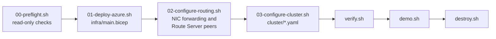

# Run and demo the lab

This is the operator runbook: from an empty subscription to a finished customer demo, and back to nothing. It tells you what to run, in what order, how long each step takes, what success looks like and what to do when a step fails.

It does not repeat the architecture or the talk track. For those, see:

- [../README.md](../README.md): what the lab is, the architecture diagram and the list of deployed resources.
- [demo-guide.md](demo-guide.md): the full customer talk track, the configuration walkthrough, the recorded evidence and the FAQ.
- [lessons-learned.md](lessons-learned.md): why the lab is built the way it is.

## Contents

- [What you get, how long it takes, what it costs](#what-you-get-how-long-it-takes-what-it-costs)
- [Prerequisites](#prerequisites)
- [Configure lab.env](#configure-labenv)
- [Step 0: preflight](#step-0-preflight)
- [Step 1: deploy Azure](#step-1-deploy-azure)
- [Step 2: route the guest network in Azure](#step-2-route-the-guest-network-in-azure)
- [Step 3: configure OpenShift](#step-3-configure-openshift)
- [Verify](#verify)
- [Troubleshooting](#troubleshooting)
- [Run the demo](#run-the-demo)
- [Reset between demos](#reset-between-demos)
- [Tear down](#tear-down)

## What you get, how long it takes, what it costs

You get an ARO cluster with OpenShift Virtualization, two Fedora guests on the routed guest network `10.101.0.0/24`, Azure Route Server, and an Ubuntu client VM `arovirt-client` (`10.50.1.4`) in a peered VNet that reaches the guests at their real IPs. The full list is in [What gets deployed](../README.md#what-gets-deployed).



| Phase | Command | Time |
|---|---|---|
| Preflight | `scripts/00-preflight.sh` | 1 to 2 minutes |
| Azure: ARO, Route Server, client VM | `scripts/01-deploy-azure.sh` | 60 to 80 minutes, plus up to 30 minutes when `TAG_MANAGED_RG=true` waits for its policy |
| Worker NIC forwarding and Route Server peers | `scripts/02-configure-routing.sh` | About 10 to 20 minutes |
| OpenShift Virtualization, BGP, guests | `scripts/03-configure-cluster.sh` | About 30 to 40 minutes |
| End-to-end check | `scripts/verify.sh` | 2 to 3 minutes |
| Customer demo | `scripts/demo.sh` | 20 to 30 minutes |
| Teardown | `scripts/destroy.sh` | About 20 minutes for the cluster, then the resource group |

Plan on about two and a half hours from preflight to a verified lab. The scripts wait for each stage, so most of that time is unattended.

What bills, by the hour, from step 1 until you delete the lab, whether or not the guests run:

- The six ARO VMs: 3 x `Standard_D8s_v5` masters and 3 x `Standard_E8as_v5` workers, with their managed disks.
- The ARO service fee for the cluster.
- Azure Route Server.
- The client VM (`Standard_D2s_v5`) and its disk.
- Standard public IPs (Route Server, client VM, ARO API and ingress) and the ARO load balancers.
- The two guest disks (about 34 GiB each) on the default ARO storage class.

There is no way to pause an ARO cluster. Use the [Azure pricing calculator](https://azure.microsoft.com/pricing/calculator/) for your region, and delete the lab when you are done.

## Prerequisites

### Tools

You need the Azure CLI with Bicep, the OpenShift CLI `oc`, `jq`, `curl` and OpenSSH on the machine you run the scripts from. Check them:

```bash
az version
az bicep install          # once; `az bicep upgrade` later
oc version --client       # from https://mirror.openshift.com/pub/openshift-v4/clients/ocp/stable/
jq --version
curl --version | head -1
ssh -V
```

The client VM and the guests already have everything the demo needs. You do not install anything on them, and the guests cannot reach the internet once the network is advertised.

### Azure permissions

You need **Owner** on the subscription, or **Contributor plus User Access Administrator**. The deployment creates role assignments on the ARO VNet for the cluster service principal and the ARO resource provider, and, with `TAG_MANAGED_RG=true`, a subscription-level policy definition and assignment.

```bash
az login
az account set --subscription "<subscription name or ID>"
az role assignment list --assignee "$(az account show --query user.name -o tsv)" \
  --include-inherited --include-groups --query "[].roleDefinitionName" -o tsv
```

### vCPU quota

The lab needs about 58 vCPUs in the region: 50 that keep running, plus 8 for the bootstrap VM that ARO uses during installation.

| Quota | Needed | For |
|---|---|---|
| Total Regional vCPUs (`cores`) | 58 | everything |
| Standard DSv5 Family vCPUs | 34 | 3 x 8 masters, 8 bootstrap, 2 client VM |
| Standard EASv5 Family vCPUs | 24 | 3 x 8 workers |

Check the free cores (limit minus used) in your region:

```bash
az vm list-usage -l australiaeast \
  --query "[?name.value=='cores' || name.value=='standardDSv5Family' || name.value=='standardEASv5Family'].{quota:localName, used:currentValue, limit:limit}" -o table
```

If a limit is too low, request an increase on the **Quotas** page in the Azure portal before you start. The preflight script checks the quota and that the three VM sizes are offered to your subscription in the region.

### Red Hat pull secret

Download it from [console.redhat.com](https://console.redhat.com/openshift/install/pull-secret). OpenShift Virtualization comes from the `redhat-operators` catalog, which needs it. Keep it outside the repository:

```bash
mkdir -p ~/.arovirt && chmod 700 ~/.arovirt
mv ~/Downloads/pull-secret.txt ~/.arovirt/pull-secret.txt && chmod 600 ~/.arovirt/pull-secret.txt
jq -e .auths ~/.arovirt/pull-secret.txt >/dev/null && echo "pull secret OK"
```

### SSH key

The public key goes onto the client VM (user `azureuser`) and both guests (user `fedora`). The private key stays on your machine: SSH to the guests jumps through the client VM, so you never copy a key to it. Create a key if you do not have one:

```bash
ssh-keygen -t ed25519 -f ~/.ssh/id_ed25519
```

The scripts use SSH in batch mode, so the private key must be usable without a prompt: either unencrypted or loaded in `ssh-agent`.

### A new cluster service principal for each build

ARO runs as a service principal that you create. Use a **new one for every build**. A failed cluster keeps its service principal's client ID, and the next attempt with the same one fails with `DuplicateClientID` ([lessons learned](lessons-learned.md#use-one-service-principal-per-cluster)).

```bash
az ad sp create-for-rbac -n "arovirt-cluster-$(date +%Y%m%d%H%M)" --skip-assignment
```

The output shows an `appId` and a `password`. Save both in your password manager straight away. Do not put them in `lab.env`, in a file in this repository or in a chat. The deployment grants the role the cluster needs.

Export them in the shell you will run the scripts from. `read -rs` keeps the password out of your shell history and off the screen:

```bash
export ARO_CLIENT_ID=<appId>
read -rs -p "ARO client secret: " ARO_CLIENT_SECRET && export ARO_CLIENT_SECRET && echo
```

Steps 1 and 2 need both variables. The scripts never write the secret to disk or put it on a command line: step 1 passes it to Bicep through an environment variable read by [../infra/main.bicepparam](../infra/main.bicepparam), and step 2 sends it to Microsoft Entra ID on `curl`'s standard input.

## Configure lab.env

```bash
cp lab.env.example lab.env      # git-ignored; the scripts source it
```

| Variable | Default | What to set |
|---|---|---|
| `SUBSCRIPTION_ID` | empty | Empty uses your current `az account`. If set, steps 1 to 3 run `az account set`, which also changes the default subscription in your other shells. The preflight script does not. |
| `RESOURCE_GROUP` | `arovirt-rg` | The lab resource group. ARO's managed resource group is always `<RESOURCE_GROUP>-managed`, and it must not exist before step 1. |
| `LOCATION` | `australiaeast` | A region that offers ARO 4.21 or later and has the quota above. The lab was built and tested in Australia East. |
| `ARO_VERSION` | empty | Empty picks the newest version offered in `LOCATION`. If you pin one, it must be 4.21 or later, because route advertisements need it. List them with `az aro get-versions -l <region> -o tsv`. |
| `PULL_SECRET_FILE` | `$HOME/.arovirt/pull-secret.txt` | Path to the Red Hat pull secret. |
| `SSH_PUBLIC_KEY_FILE` | `$HOME/.ssh/id_ed25519.pub` | Public key for the client VM and the guests. |
| `MY_IP` | empty | The CIDR allowed to SSH to the client VM, for example `203.0.113.10/32`. Empty uses your current public IP, looked up when step 1 runs. Use a stable address or range if you will present from somewhere else. |
| `TAG_MANAGED_RG` | `true` | `true` deploys [../infra/managed-rg-tag-policy.bicep](../infra/managed-rg-tag-policy.bicep), which tags the ARO-managed resource group with `SecurityControl=Ignore` when ARO creates it. Keep it `true` where an inherited policy disables shared-key access on storage accounts, which breaks ARO bootstrap with `KeyBasedAuthenticationNotPermitted` ([lessons learned](lessons-learned.md#azure-policy-can-break-aro-bootstrap)). Set it to `false` in subscriptions without such a policy: step 1 then skips the policy and its wait of up to 30 minutes. |

The cluster service principal is not in this file. Export it as shown above.

## Step 0: preflight

```bash
scripts/00-preflight.sh
```

It is read-only. It creates nothing in Azure, does not change your Azure CLI default subscription and never prints a secret. It checks:

- the tools, and that Bicep is installed for the Azure CLI
- that you are signed in, which subscription and identity it will use, and your roles on the subscription
- `lab.env`, that the pull secret is valid JSON, that the SSH public key is valid, and `MY_IP`
- that `ARO_CLIENT_ID` and `ARO_CLIENT_SECRET` are exported, that the service principal exists, and that no other ARO cluster in the subscription already uses it
- that the ARO resource provider's service principal is in the tenant and that `LOCATION` offers ARO 4.21 or later
- that no earlier attempt left the resource group or the managed resource group behind
- the vCPU quota, and that the VM sizes are offered to you in the region

Each check prints `PASS`, `WARN` with advice, or `FAIL` with the fix, for example:

```text
==> Cluster service principal
  ARO_CLIENT_ID set (<appId>): PASS
  service principal exists (arovirt-cluster-202610100930): PASS
  service principal not used by any ARO cluster in this subscription: PASS
  ARO_CLIENT_SECRET set (not shown): PASS
```

It exits non-zero if anything fails. Fix the failures and rerun it until it ends with `Ready: ... Next: scripts/01-deploy-azure.sh`. Read the warnings too: a warning about the service principal being in use means step 1 will fail with `DuplicateClientID`.

## Step 1: deploy Azure

```bash
scripts/01-deploy-azure.sh
```

Takes 60 to 80 minutes, mostly ARO. It:

1. Registers the resource providers and picks the ARO version.
2. With `TAG_MANAGED_RG=true`, deploys [../infra/managed-rg-tag-policy.bicep](../infra/managed-rg-tag-policy.bicep) as the subscription deployment `arovirt-mrg-tag-policy`, then waits up to 30 minutes until a throwaway resource group with the managed resource group's name gets the tag.
3. Creates the resource group and deploys [../infra/main.bicep](../infra/main.bicep) with [../infra/main.bicepparam](../infra/main.bicepparam) as the resource group deployment `arovirt`: the ARO VNet, Route Server, the client VNet, NSG and VM, the peerings with gateway transit, and the ARO cluster last.

For why it is built in that order, see [Deploy](../README.md#deploy) in the README.

Watch it from a second terminal:

```bash
source lab.env
az deployment group show -g "$RESOURCE_GROUP" -n arovirt --query properties.provisioningState -o tsv
az deployment operation group list -g "$RESOURCE_GROUP" -n arovirt \
  --query "[].{resource:properties.targetResource.resourceName, state:properties.provisioningState}" -o table
az aro list -g "$RESOURCE_GROUP" --query "[].{name:name, state:provisioningState}" -o table
```

Success: the script ends with the cluster name, the console URL, `Client VM: ssh azureuser@<public IP>` and `Next: scripts/02-configure-routing.sh`, and `az aro list` shows `Succeeded`.

`main.bicep` is deployed only once. Rerunning step 1 after it succeeded just prints the outputs again. If your terminal drops while the deployment runs, do not rerun step 1: the deployment carries on in Azure. Watch it with the commands above until it reports `Succeeded`, then rerun step 1 to print the outputs. If the cluster failed, see [Troubleshooting](#troubleshooting).

## Step 2: route the guest network in Azure

```bash
scripts/02-configure-routing.sh
```

Needs `ARO_CLIENT_ID` and `ARO_CLIENT_SECRET` in the shell. It:

1. Finds the three worker NICs in the managed resource group and turns on IP forwarding on each one. The NICs sit behind ARO's deny assignment, so the script signs in as the cluster service principal, which the deny assignment exempts, and updates each NIC through the ARM REST API.
2. Deploys [../infra/route-server-peers.bicep](../infra/route-server-peers.bicep) as the deployment `arovirt-peers`: one Route Server BGP peer (ASN 65001) per worker, created one at a time.

Watch it:

```bash
az network nic list -g "$RESOURCE_GROUP-managed" \
  --query "[?contains(name, 'worker')].{name:name, ip:ipConfigurations[0].privateIPAddress, ipForwarding:enableIPForwarding}" -o table
az network routeserver peering list -g "$RESOURCE_GROUP" --routeserver arovirt-rs -o table
```

Success: three worker NICs with `ipForwarding` `True`, a table of three peers in state `Succeeded`, and `Route Server BGP IPs: 10.0.4.4, 10.0.4.5` (in either order).

The step is idempotent. Rerun it, then step 3, after any change that replaces or adds a worker (scale-out, repair, upgrade): new workers come up with forwarding off and no peer.

## Step 3: configure OpenShift

```bash
scripts/03-configure-cluster.sh
```

Takes about 30 to 40 minutes. It writes the admin kubeconfig to `.arovirt/kubeconfig`, then applies the manifests in [../cluster/](../cluster/) in this order, waiting for each stage:

| Order | What | Manifest |
|---|---|---|
| 1 | OpenShift Virtualization operator, then the `HyperConverged` instance | [virtualization-operator.yaml](../cluster/virtualization-operator.yaml), [hyperconverged.yaml](../cluster/hyperconverged.yaml) |
| 2 | FRR and route advertisements in the cluster network operator | a patch in the script |
| 3 | BGP peering from the labelled workers to both Route Server instances, then a wait for 2 established sessions per worker | [frr-configuration.yaml](../cluster/frr-configuration.yaml) |
| 4 | The guest namespace and primary Layer2 network, the SSH key Secret, and the two Fedora guests | [guest-network.yaml](../cluster/guest-network.yaml), [guests.yaml](../cluster/guests.yaml) |
| 5 | A wait until cloud-init has installed the guest packages, then the route advertisement | [route-advertisements.yaml](../cluster/route-advertisements.yaml) |

Order 5 matters: advertising the network removes its egress SNAT, and with it the guests' internet access. Do not apply `route-advertisements.yaml` by hand before the guests are ready.

Watch it from a second terminal:

```bash
export KUBECONFIG=$PWD/.arovirt/kubeconfig
oc get csv -n openshift-cnv                     # kubevirt-hyperconverged-operator ... Succeeded
oc get hyperconverged -n openshift-cnv
oc get ds frr-k8s -n openshift-frr-k8s          # 6 desired, 6 ready
oc get vm,vmi,dv -n arovirt-guests              # disks import, then the guests start
oc get routeadvertisements                      # appears at the very end
```

Success: the script prints both guests `Running`, each with a `10.101.0.x` IP on a different worker, and `Next: scripts/verify.sh`.

The step is idempotent, so you can rerun it after fixing a problem.

## Verify

```bash
scripts/verify.sh
```

It checks, read-only: 2 Established BGP sessions on each worker, `10.101.0.0/24` learned by both Route Server instances from every worker, an active BGP route for the guest network on the client VM's NIC, and a ping from the client VM to each guest. It ends with `All checks passed`, or exits non-zero with the number of failed checks.

The lab is now ready to demo.


## Run the demo

### Before the customer joins

From the repository root, signed in to Azure:

```bash
eval "$(scripts/demo.sh env)"      # sets RG, CLUSTER, MRG, RS, CLIENT_IP, GA, GB and KUBECONFIG
scripts/verify.sh                  # must end with "All checks passed"
```

The variables are the same ones [demo-guide.md](demo-guide.md#0-before-the-demo) uses, so every command in that guide works in the same shell. If you present from a different network than `MY_IP`, add the temporary SSH rule described there first. Open the browser tabs listed in its [pre-flight](demo-guide.md#pre-flight-5-minutes-before-the-customer-joins) section.

### Run sheet (about 25 minutes)

`scripts/demo.sh` runs each live proof with one command. The traffic proofs take `a` or `b` for `fedora-a` or `fedora-b` (default `a`), print `PASS` when the evidence shows the original addresses, and exit non-zero otherwise. They start a listener that serves one request or a fixed number of packets, bounded by `timeout`, so nothing is left running. IPs below are examples: your guests may get other `10.101.0.x` addresses.

**1. The story (3 minutes).** No command. Show the diagram in the [README](../README.md) and tell the story in [section 1](demo-guide.md#1-the-story-and-architecture) of the demo guide: the guest network is a real routed network in Azure, with no NAT, UDRs or appliances.

**2. What runs where (2 minutes).**

```bash
scripts/demo.sh status
```

Say: six nodes, two guests that each own a `10.101.0.x` address on different workers, one accepted route advertisement, FRR on every node. To show the address from inside a guest, see [section 2](demo-guide.md#2-before-and-after-what-nat-used-to-hide).

**3. BGP from both sides (4 minutes).**

```bash
scripts/demo.sh bgp
```

Expected (trimmed):

```text
==> BGP sessions on each worker (ASN 65001 to Route Server, ASN 65515)
  <worker 1>  10.0.4.4  Established  up 02w2d05h  received 1  sent 1
  <worker 1>  10.0.4.5  Established  up 02w2d05h  received 1  sent 1
  ...
==> Routes Route Server learned for 10.101.0.0/24 (10-15 seconds per peer)
  10.0.4.5  10.101.0.0/24  via 10.0.2.4  AS 65001
  10.0.4.4  10.101.0.0/24  via 10.0.2.4  AS 65001
  ...
==> Routes Route Server advertises to <worker 1> (the workers accept only 10.50.0.0/16)
  10.0.4.4  10.0.0.0/20  AS 65515
  10.0.4.4  10.50.0.0/16  AS 65515
```

Say: each worker holds two eBGP sessions, one per Route Server instance, and announces the guest network; Route Server learned it with each worker as the next hop. Background: [section 5](demo-guide.md#5-prove-bgp-is-up).

**4. Azure routes the guest network natively (3 minutes).**

```bash
scripts/demo.sh routes
```

Expected:

```text
==> Effective routes for 10.101.0.0/24 on arovirt-client-nic (about 20 seconds)
  VirtualNetworkGateway  Active  10.101.0.0/24  VirtualNetworkGateway  10.0.2.6
  VirtualNetworkGateway  Active  10.101.0.0/24  VirtualNetworkGateway  10.0.2.5
  VirtualNetworkGateway  Active  10.101.0.0/24  VirtualNetworkGateway  10.0.2.4
```

Say: an ordinary Azure VM's NIC has a BGP-learned route for the guest network, with the three worker IPs (listed above it, with IP forwarding on) as equal-cost next hops. Nobody wrote a route table. Background: [section 6](demo-guide.md#6-prove-azure-routes-the-guest-network-natively).

**5. The guest sees the client's packets (3 minutes).**

```bash
scripts/demo.sh capture a
```

Expected:

```text
==> Capture on fedora-a
  ... enp1s0 In  IP 10.50.1.4 > 10.101.0.9: ICMP echo request, id 51492, seq 1, length 64
  ... enp1s0 Out IP 10.101.0.9 > 10.50.1.4: ICMP echo reply, id 51492, seq 1, length 64
  ...
  fedora-a received the pings from 10.50.1.4 itself: PASS
```

Say: this capture runs on the guest's own NIC, and the request comes from `10.50.1.4`, not from a worker or a load balancer. Background: [section 7.1](demo-guide.md#71-azure-vm-to-guest-ping-captured-on-the-guest).

**6. Inbound: the guest's application logs the client's real IP (3 minutes).**

```bash
scripts/demo.sh inbound a
```

Expected:

```text
HTTP 200 from 10.101.0.9:5201, local 10.50.1.4
==> Access log on fedora-a
  10.50.1.4 - - [06/Oct/2026 09:26:15] "GET / HTTP/1.1" 200 -
  fedora-a saw the source address 10.50.1.4: PASS
```

Say: audit logs, IP allow lists and licence servers on the guest see the real client. Background: [section 7.2](demo-guide.md#72-azure-vm-to-guest-the-application-sees-the-clients-real-ip).

**7. Outbound: no source NAT on the way out (3 minutes).**

```bash
scripts/demo.sh outbound b
```

Expected:

```text
fedora-b runs on worker <worker name> (10.0.2.4). With SNAT, the client VM would see 10.0.2.4.
HTTP 200 from 10.50.1.4:5201, local 10.101.0.8
==> Access log on arovirt-client
  10.101.0.8 - - [06/Oct/2026 09:26:42] "GET / HTTP/1.1" 200 -
  arovirt-client saw the source address 10.101.0.8: PASS
```

Say: the Azure VM sees the guest's own address, not the worker's, which is why an Azure NSG rule can match `10.101.0.0/24`. Background: [section 7.3](demo-guide.md#73-guest-to-azure-vm-no-source-nat-on-the-way-out).

**8. Optional: UDP (2 minutes).**

```bash
scripts/demo.sh udp a
```

It runs iperf3 UDP from the client VM to the guest for 5 seconds at 10 Mbit/s and shows the guest's iperf3 server reporting `Accepted connection from 10.50.1.4`. The numbers are a sanity check, not a benchmark: the recorded tests did not measure throughput.

**9. Close (3 minutes).** Show the recorded 12-case matrix in [section 9](demo-guide.md#9-recorded-evidence-the-12-case-matrix) and be clear about the support position in [Position it honestly](demo-guide.md#position-it-honestly). Use the [FAQ](demo-guide.md#common-questions) for questions.

For a longer session (40 to 50 minutes), add the configuration walkthrough in sections [3](demo-guide.md#3-azure-side-route-server-peering-and-forwarding), [4](demo-guide.md#4-walk-through-the-openshift-configuration) and [8](demo-guide.md#8-the-packet-path-why-there-is-no-nat) of the demo guide.

## Reset between demos

There is little to reset. Every `demo.sh` listener exits after one request or a fixed number of packets, and `timeout` stops it within 30 seconds if no traffic arrives.

1. If you ran commands from the demo guide by hand, check that nothing still listens on port 5201, with the commands in [section 11](demo-guide.md#11-reset-after-the-demo).
2. Remove the temporary SSH rule if you added one: `az network nsg rule delete -g "$RG" --nsg-name arovirt-client-nsg -n Temp-Demo-SSH`.
3. Before the next demo, run `scripts/verify.sh` again. Guest IPs survive restarts (persistent IPAM), but rerun `eval "$(scripts/demo.sh env)"` in any new shell.
4. If a worker was replaced or added since the last demo, rerun steps 2 and 3 first.

## Tear down

```bash
scripts/destroy.sh     # asks you to type the resource group name
```

It deletes the ARO cluster (about 20 minutes), which removes the managed resource group, then the lab resource group, then the tagging policy, and finally the local `.arovirt/` folder with the kubeconfig. Check that both resource groups are gone:

```bash
az group show -n "$RESOURCE_GROUP" -o none 2>/dev/null && echo "still there" || echo "deleted"
az group show -n "$RESOURCE_GROUP-managed" -o none 2>/dev/null && echo "still there" || echo "deleted"
```

The script leaves the cluster service principal alone. Delete its app registration, which also deletes the service principal, then remove it from your password manager and your shell:

```bash
az ad app delete --id "$ARO_CLIENT_ID"
unset ARO_CLIENT_ID ARO_CLIENT_SECRET
```

If you will rebuild the lab, also remove the guests' old host keys (`ssh-keygen -R <guest IP>` for each), because a rebuilt guest can reuse an address with a new key.
